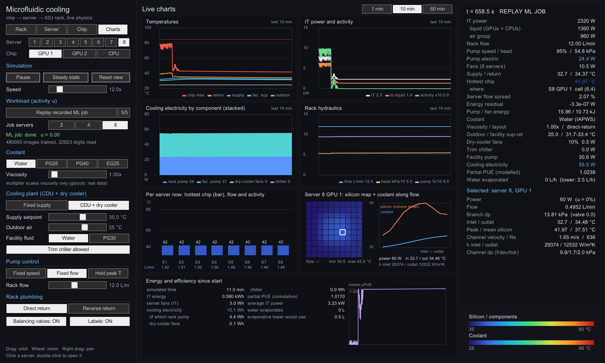
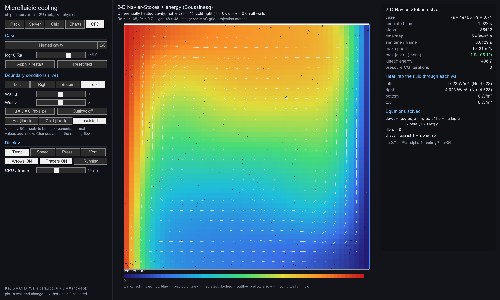
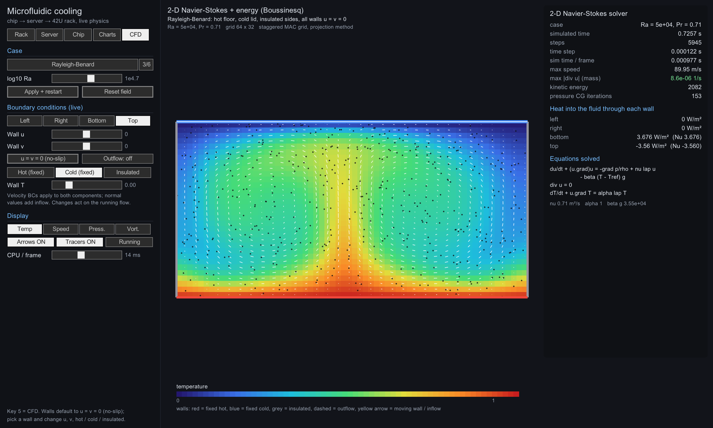
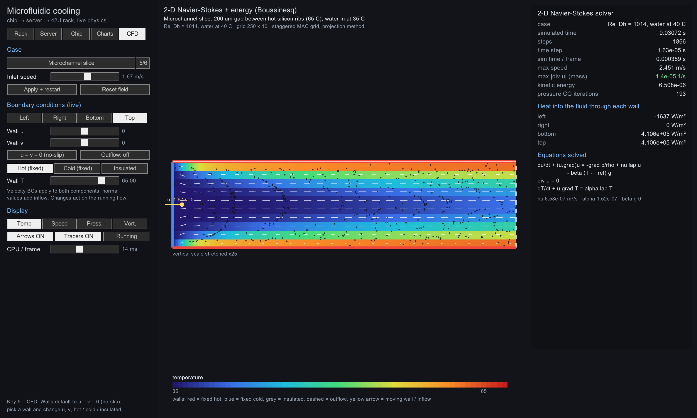
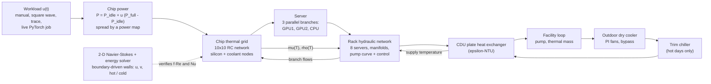

# Microfluidic cooling in a data center: simulation

A physics-based C++ simulation, with a live 3D viewer, of a liquid-cooled 42U server rack and its cooling plant. It is built up from a single microchannel-cooled chip and driven by a real PyTorch machine-learning job. A 2-D Navier–Stokes + energy solver, with boundary-driven hot and cold walls, checks the fluid physics from first principles.

**Research question.** Microfluidic cooling (coolant etched through the silicon, as Microsoft demonstrated) and closed-loop, non-evaporative coolant systems (as NVIDIA describes) both promise to cut cooling energy and water use. This project combines the two. It asks whether **coolant viscosity**, which makes fluid harder to push through tiny channels, limits those savings.


| Server: 2 microchannel GPUs + cold-plate CPU | Chip: silicon heat map + microchannels | Live charts dashboard |
|---|---|---|
|  |  |  |

| Navier–Stokes: heated cavity (hot / cold walls, u = v = 0) | Rayleigh–Bénard convection | Microchannel slice (hot ribs, cold inflow) |
|---|---|---|
|  |  |  |

**Documents:**
- **[Results report](docs/report/REPORT.md):** 13 figures with written analysis, from chip to climate, the ML job and the Navier–Stokes checks, regenerated from the simulation.
- **[Parameters and assumptions](docs/parameters.md):** every input, its source, and the hand calculations.
- **[CNN workload](docs/ml_workload.md):** the PyTorch job and its co-simulation.
- **[Navier–Stokes and energy equations](docs/cfd.md):** what is solved where, the 2-D solver, boundary conditions and benchmarks.
- **Schematics:** [chip](docs/schematics/chip.svg), [server](docs/schematics/server.svg), [rack](docs/schematics/rack.svg), [cooling plant](docs/schematics/plant.svg).

---

## Contents

1. [Key results](#1-key-results)
2. [How the simulation works](#2-how-the-simulation-works)
3. [Verification](#3-verification)
4. [Running it](#4-running-it)
5. [Repository layout](#5-repository-layout)
6. [Assumptions and limitations](#6-assumptions-and-limitations)

---

## 1. Key results

All numbers come from the simulation; the [results report](docs/report/REPORT.md) has the figures. The baseline is 8 servers at full load (8 kW IT, 6.4 kW to liquid), water coolant, 35 °C supply, 25 °C outdoors and an 85 °C chip limit.

| Question | Answer |
|---|---|
| Are the Navier–Stokes and energy equations solved? | **Both levels.** The rack model conserves energy exactly and uses laminar duct correlations, which are themselves Navier–Stokes solutions. A separate 2-D Navier–Stokes + energy solver re-derives them for our channel (f·Re 16.36 vs 16.38; Nu 4.93 vs 4.89) and matches the Ghia (lid cavity) and de Vahl Davis (heated cavity) benchmarks. |
| Does the chip model match hand calculations? | Yes. Re 658 (hand: ≈ 660), channel Δp 13.5 kPa (12–15), GPU outlet 43.67 °C (43.7), rack mixed return 42.70 °C (42.7). The heat balance closes to about 1e-8 W. |
| How hot does a 300 W microchannel GPU get? | 65.9 °C with uniform heating; **81.9 °C** with the assumed hotspot (50 % of the power in 25 % of the die). |
| Does viscosity raise chip temperature? | **Not at a given flow.** Holding 85 °C needs 10.1 L/min at 1× and at 4× viscosity, because Re·Pr contains no μ. |
| What does viscosity cost? | **Pumping energy.** The rack pump needs 14.7 W at 1× and 37.5 W at 4×. With the cooling plant, viscosity also weakens the CDU heat exchanger (UA −19 %), so total cooling rises 70 → 110 W at 25 °C and 557 → 658 W at 30 °C. |
| And if the pump isn't adjusted? | Flow drops to 8.2 L/min at 4× and the hottest chip reaches **89.4 °C**. |
| Real coolants? | **PG25 costs about 4× the pumping and 2.2× the cooling electricity of water.** Lower conductivity (−23 %) and heat capacity mean 55 % more flow on top of higher viscosity. PG40 costs about 4.5× the cooling electricity. |
| Water use? | **Zero evaporation.** An evaporative tower would use about 9.5 L/h for the same heat. The trade-off is electricity on hot days: partial PUE is 1.010 at 25 °C, 1.074 at 30 °C and 1.134 at 40 °C. |
| A full day (16–32 °C, afternoon peak load)? | 113 kWh IT, 4.2 kWh cooling, partial PUE 1.037, 0 L of water (a tower would evaporate about 124 L). |
| A real ML job? | The PyTorch CNN reaches 99.35 % on MNIST. With constant flow, cooling barely follows the job. **Variable flow with load feedforward** cuts cooling energy 36 % and keeps PG25 below 85 °C; feedback-only control overshot to 116 °C. |

---

## 2. How the simulation works

### 2.1 Architecture



The dashed link is a check, not a runtime coupling: the CFD solver independently re-derives the channel friction and heat-transfer coefficients the chip grid uses. The physics lives in a headless library (`src/core`). Two programs use it: the `mfsim` command-line tool for experiments, and `mfsim_viewer` for live 3D. Everything is SI internally, and configs carry units in their key names.

### 2.2 Coolant properties

| Fluid | Source | Notes |
|---|---|---|
| Water | **IAPWS-IF97** Region 1 (density, c_p), **IAPWS 2008** viscosity, **IAPWS 2011** conductivity | Matches the releases' verification values to every digit. Tabulated at 0.1 K for speed. |
| Propylene / ethylene glycol | **Melinder (2010, IIR)** correlations, coefficients from CoolProp | Named by volume percent (`PG25`, `EG25`, `PG40`) or mass percent (`PG30m`). Includes freezing points. At zero concentration it matches IAPWS within 0.6 %. |
| Viscosity-only fluid | Water with μ × k | For the "isolate viscosity" experiment (ρ, c_p, k unchanged). |

Component pressure-drop curves are specified for water. A more viscous coolant therefore raises the laminar part of every component's pressure drop.

### 2.3 Chip: microchannel GPU

| Geometry | Value |
|---|---|
| Die | 20 × 20 mm, 0.8 mm silicon |
| Channels | 50, each 200 µm wide × 500 µm deep × 20 mm long, with 200 µm ribs |
| Floor under channels | 300 µm |

**Thermal network.** The die is a 10 × 10 grid. Each cell has two nodes:
- a **silicon node** (the heated active face), with heat input, capacitance, and conduction to its 4 neighbours (ribs conduct along the flow, only the floor across it);
- a **coolant node**, with upwind advection from the upstream cell, so the coolant warms along the channel.

Silicon connects to coolant through the floor's conduction resistance in series with finned convection, h·(w + 2dη)·Δx, where η = tanh(mH)/mH is the rib fin efficiency.

**Correlations** (Shah & London):
- fully developed friction f·Re(α) for rectangular ducts;
- the Hagenbach K(∞) excess pressure drop for developing flow;
- header contraction and expansion losses;
- a three-wall-heated Nusselt number with a thermal-entrance enhancement.

The flow is laminar (Re ≈ 660) and still thermally developing over the whole channel. The heat-transfer coefficient falls from 29.6 to 12.8 kW/m²K along it.

**CPU** uses the same grid with a conventional cold plate: TIM, a copper base layer, then finned passages. Its fin-side conductance scales with flow and fluid properties.

**Power map:** uniform, an assumed hotspot block, or a custom map.

### 2.4 Server

```
supply ─ QD ─┬─ hose ─ GPU 1 microchannels ─ valve ─┬─ QD ─ return
             ├─ hose ─ GPU 2 microchannels ─ valve ─┤
             └─ hose ─ CPU cold plate      ─ valve ─┘        + 200 W air-cooled group (fans, room air)
```

- **Branch flows are solved** from equal pressure drop across the parallel branches, not assumed.
- **Balancing valves** are sized automatically so each branch gets 0.5 L/min. Without them the CPU branch takes 0.78 L/min and the GPUs heat to 87.5 °C.
- **The air-cooled group** (memory, storage, other electronics) is a lumped node. Its fans hold a 12 K air temperature rise, and fan power scales with flow cubed.

### 2.5 Rack hydraulics

- **Layout:** 42U, with 8 × 4U servers in U7–U38, CDU and pump in U1–U6, network in U39–40 and spare U41–42.
- **Manifolds:** rear supply and return manifolds (Churchill friction plus tee losses), in a **direct-return** or **reverse-return** layout.
- **Network solver:** a Newton–Raphson solve for node pressures. Each component's monotonic Δp(ṁ) law is inverted per edge, and mass is conserved at every node. Hydrostatics (ρgz) is included and cancels around the closed loop.
- **Pump:** quadratic head curve, affinity laws, efficiency curve, and electric power = Δp·V̇ / (η_pump·η_motor).
- **Pump control modes:**
  - **fixed speed;**
  - **fixed flow** (bisection on speed);
  - **hold the hottest chip at a target**, with load feedforward: speed = k × chip power + Kp × error. The gain k is integrated from the temperature error with anti-windup, and the pump never drops below 30 % speed.
- **Pressure budget** at 12 L/min, 52.4 kPa in total:

  | Component | Share |
  |---|---|
  | CDU heat exchanger | 46 % |
  | GPU microchannel branch | 25 % |
  | Filter | 15 % |
  | Quick disconnects | 11 % |
  | Manifolds | 3 % |

### 2.6 Cooling plant

| Component | Model |
|---|---|
| CDU | Counterflow plate heat exchanger, ε-NTU. Each side's hA ∝ ṁ^0.6 μ^(1/3−0.6) k^(2/3) c_p^(1/3), so viscosity lowers it. |
| Facility loop | Sealed water (or PG30 for frost) at 14 L/min. Pump power scales with fluid properties. |
| Dry cooler | Finned coil, crossflow ε-NTU. Variable-speed fans (P ∝ speed³) under PI control of the 35 °C supply. |
| Bypass / economizer | Water bypasses the dry cooler when outdoor air is warmer than the water, or when its fans would cost more than the chiller power they save. |
| Trim chiller | Only when fans at full speed cannot hold the setpoint. COP = 0.5 × Carnot, capped at 10. |
| Thermal mass | 6 + 8 L in the equipment loop, 25 L in the facility loop. |
| Weather | Constant, or a daily sine. |
| Freeze check | Flags outdoor air within 2 K of the facility fluid's freezing point. |

### 2.7 Workloads

- **Manual sliders** per server.
- **Square waves**, in sync or staggered.
- **Step, CSV trace, or daily trace.**
- **ML job:** a PyTorch CNN, live or replayed. `ml/train_mnist.py` trains on MNIST (99.35 %), then scans synthetic pages of handwritten digits on demand (99.2 % read correctly). It records device activity u(t) every 0.1 s. The viewer can follow that file live, and `mfsim cosim` replays it on the rack and plant with per-phase energy accounting.

### 2.8 Energy, efficiency and water accounting

- **Energy ledgers** at chip, server and rack level: power in = heat to coolant + stored heat. Residuals are reported live.
- **Electricity:** rack and facility pumps, dry-cooler fans, chiller, and server fans (counted as IT).
- **Partial PUE** = (IT + server fans + cooling) / (IT + server fans).
- **Water:** evaporated water (always 0 for this loop), and what an evaporative tower would evaporate for the same heat (2.43 MJ/kg).

### 2.9 First-principles CFD: Navier–Stokes + energy

`src/core/cfd` solves the full 2-D incompressible Navier–Stokes and energy equations with Boussinesq buoyancy:

```
∂u/∂t + (u·∇)u = −∇p/ρ + ν∇²u − β(T − T_ref)g,    ∇·u = 0,    ∂T/∂t + u·∇T = α∇²T
```

- **Method:** staggered (MAC) finite volumes and a Chorin projection, with the pressure Poisson equation solved by preconditioned conjugate gradients. The flow is divergence-free to about 1e-6 s⁻¹, with an adaptive time step.
- **Boundary-driven:** every wall prescribes both velocity components (u, v). They default to 0 (no-slip) and can be changed to make a moving wall or an inflow, or the wall can be set to outflow. Every wall is also held at a fixed hot or cold temperature, given a fixed heat flux, or insulated. All of these can change while the flow runs.
- **Cases:** lid-driven cavity, heated cavity, Rayleigh–Bénard, mixed convection, channel flow, a microchannel slice with real water properties, and a fully developed solve of the 200 × 500 µm duct.
- **Benchmarks:**

  | Case | This solver | Published |
  |---|---|---|
  | Lid-driven cavity, Re = 100 | centreline velocity within 0.005 | Ghia, Ghia & Shin (1982) |
  | Heated cavity, Ra = 10⁴ / 10⁵ | Nu 2.252 / 4.575 | 2.243 / 4.519 (de Vahl Davis 1983) |
  | Channel flow | pressure gradient −0.3 % | analytic |
  | Rayleigh–Bénard | Nu = 1 below Ra ≈ 1708, convection above | theory |

See [docs/cfd.md](docs/cfd.md).

### 2.10 Numerical methods

- **Chip:** implicit backward Euler, unconditionally stable. This is needed because the silicon time constant is about 30 ms and coolant transit about 1 ms. Each step uses a Gauss–Seidel solve; temperature-dependent coefficients are lagged one step.
- **Steady states:** pseudo-transient continuation for chips, fixed-point coupling of the hydraulic and thermal solutions, and bisection where a target must be met (pump speed for a peak limit, fan speed for a setpoint).
- **Time stepping:** the viewer runs fixed sub-steps decoupled from the frame rate, and the hydraulic solve is refreshed every 50 ms of simulated time.

---

## 3. Verification

`ctest` runs 46 test cases (709 assertions) in about a minute:

| Area | What is checked |
|---|---|
| Fluids | IAPWS check values: IF97 v and c_p, 2008 μ, 2011 k. Tabulated vs exact. Melinder → water at zero concentration. Glycol freezing points. |
| Channel | Analytic f·Re; Δp exactly ∝ μ in the fully developed limit; the hand-calculation numbers. |
| Chip | Coolant energy balance within 0.1 %; per-step energy conservation; a symmetric field for a symmetric map; grid refinement; viscosity-independent temperature at fixed flow; the cold plate. |
| Network | Analytic flow split; mass conservation at every node; elevation cancelling around a loop; pump affinity laws. |
| Server / rack | Valve auto-balance (also with PG25); unbalanced CPU flow; 42.7 °C mixed return; reverse-return evenness; pump operating point on its curve; PI hold; feedforward overshoot < 86 °C. |
| Plant | ε-NTU limits; setpoint held on mild days; chiller and economizer on hot days; minimum fans on cold days; transient recovery after a load step; viscosity lowering CDU UA; freeze flag. |
| ML trace | Replay timing, offset and scale; idle before and after the job; live file growth. |
| Navier–Stokes | Duct f·Re and Nu vs Shah & London; Ghia lid cavity; de Vahl Davis heated cavity with heat in = heat out; Rayleigh–Bénard onset; channel pressure gradient, parabolic profile and mass conservation; walls at rest give no flow; reversing the lid mirrors the flow. |

---

## 4. Running it

### Build

You need CMake 3.24 or newer and a C++20 compiler (Xcode command-line tools on macOS; on Linux also the X11/OpenGL dev packages for raylib). The first configure downloads raylib 5.5, raygui 4.0, doctest 2.4.11 and nlohmann/json 3.11.3, each pinned by SHA-256.

```bash
cmake -S . -B build -DCMAKE_BUILD_TYPE=Release
```

```bash
cmake --build build -j
```

```bash
ctest --test-dir build --output-on-failure
```

### 3D viewer

```bash
./build/mfsim_viewer --config configs/plant_baseline.json
```

| Scene (key) | What you see |
|---|---|
| Rack (1) | 42U rack, servers glowing by chip temperature, manifolds with flow labels, CDU, outdoor dry cooler and chiller |
| Server (2) | Cut-away 4U server: GPU and CPU heat maps, hoses coloured by temperature, fans |
| Chip (3) | Exploded die: silicon heat map, 50 microchannels coloured by coolant temperature, hotspot marker |
| Charts (4) | Live dashboard over 1 / 10 / 60 min: temperatures, IT power, stacked cooling electricity, hydraulics, per-server bars, chip heat map with along-flow profiles, energy and partial PUE |
| CFD (5) | 2-D Navier–Stokes + energy solver running live: temperature, speed, pressure or vorticity field, velocity arrows, tracer particles. Pick a case, then set each wall's u, v, hot / cold / insulated and outflow while it runs. |

**Controls:** left-drag orbits, right-drag pans, the wheel zooms, Space pauses, and a double-click opens a server. The left panel sets:
- the workload (sliders, square waves, live or replayed ML job, 2/4/8 job servers);
- the coolant and its viscosity multiplier;
- the plant (on/off, setpoint, outdoor temperature, facility fluid, chiller);
- the pump mode and target, and the manifold layout and valves.

Useful flags: `--scene cfd --cfd-case rayleigh-benard`, `--scene charts`, `--speed 10`, `--coolant PG25`, `--outdoor 32`, `--job replay`, and `--screenshot out.png --frames 300`.

### Experiments (command line)

| Command | What it does |
|---|---|
| `mfsim info` | Hand-check quantities for one GPU (Re, Δp, entrance lengths, h) |
| `mfsim steady --level chip\|server\|rack\|plant [--out f.csv]` | Steady state, tables, CSV maps |
| `mfsim run --duration 600 --dt 0.05` | Transient time series to CSV |
| `mfsim resolution` | Grid-resolution check |
| `mfsim sweep-viscosity --scales 1,2,4` | Fixed flow / fixed pump speed / hold-85 °C at each viscosity |
| `mfsim coolant-compare` | Water, PG25, PG40, EG25 with real properties |
| `mfsim climate-sweep --temps 0,10,20,30,40` | Cooling electricity and partial PUE vs outdoor temperature |
| `mfsim uneven-load` | Half the rack busy, direct vs reverse return |
| `mfsim hydraulics` | Loop pressure budget, pump and system curves |
| `mfsim cfd --case heated-cavity --value 1e5` | 2-D Navier–Stokes + energy case. Wall overrides: `--left-u`, `--top-T`, `--bottom-insulated`, `--right-outflow`, … Also `--case duct` for the fully developed check |
| `mfsim cosim --trace results/ml/activity_trace.csv` | Replay a recorded ML job on the rack and plant |

Common options: `--config F`, `--level`, `--coolant`, `--facility-coolant`, `--viscosity`, `--outdoor`, `--chiller off`, `--pump-mode flow|speed|peak`, `--target-peak C`. Configs live in `configs/`; JSON keys carry units, and `//` comments are allowed.

### Full results report

```bash
.venv/bin/python analysis/make_report.py
```

This reruns every experiment, including the Navier–Stokes cases (about 13 minutes), and rewrites [docs/report/REPORT.md](docs/report/REPORT.md) and its figures. `--no-sim` only redraws from saved data.

### Machine-learning job

```bash
python3 -m venv .venv && .venv/bin/pip install torch torchvision matplotlib
```

```bash
ml/live_demo.sh 8 8
```

```bash
ml/run_job.sh 8 water,PG25
```

`ml/live_demo.sh` shows the viewer following the job live. `ml/run_job.sh` trains, co-simulates and writes `results/ml/report.png`.

---

## 5. Repository layout

```
src/core/
  fluid/        IAPWS water, Melinder glycols, viscosity-scaled fluid
  hydraulics/   rectangular microchannel model, edge laws (pipes, losses, pump), network solver
  thermal/      chip RC grid (microchannel + cold plate), power maps, air-cooled group
  system/       server, rack (manifolds, pump control), cooling plant (CDU, dry cooler, chiller), data center
  workload/     constant / step / square / trace / ML job trace (replay + live)
  config/       JSON configs -> parameter structs
  cfd/          2-D Navier-Stokes + energy (projection, MAC grid), fully developed duct flow, case presets
apps/mfsim/     experiments command-line tool
apps/viewer/    raylib + raygui 3D viewer and live charts dashboard
ml/             PyTorch CNN, page scanner, activity monitor, job report, run scripts
analysis/       report generator (runs experiments, draws figures, writes REPORT.md)
configs/        baseline and scenario configs
tests/          doctest unit tests
docs/           report, parameters, ML workload, schematics, screenshots
```

---

## 6. Assumptions and limitations

- **Assumed inputs.** Several inputs are study assumptions, tagged ASSUMED in [parameters.md](docs/parameters.md):
  - the GPU hotspot map and idle powers;
  - the cold-plate, quick-disconnect, CDU, filter, dry-cooler, chiller and pump curves;
  - the loop volumes.
- **Simplifications.**
  - The rack model uses Navier–Stokes only through verified duct correlations. The CFD solver is 2-D, laminar and constant-property (Boussinesq); it checks the reduced model rather than replacing it.
  - The chip is a 2-D grid with lumped ribs.
  - Microchannel heat transfer uses a thermal-entrance approximation.
  - Flow is equal across the 50 channels.
  - There is no thermosiphon.
- **Uncertainty.** Glycol viscosity is about ±20 % between published data sets, and inhibitors change it.
- **ML energy per image** assumes each simulated GPU runs at the measured laptop GPU's speed. The load pattern transfers; the absolute per-image energy is illustrative.
- **Not modelled:** room HVAC for the 1.6 kW air-cooled load (water-use statements cover the liquid loop only), humidity, and part-load optimisation of fans and chiller together.

## License

MIT
