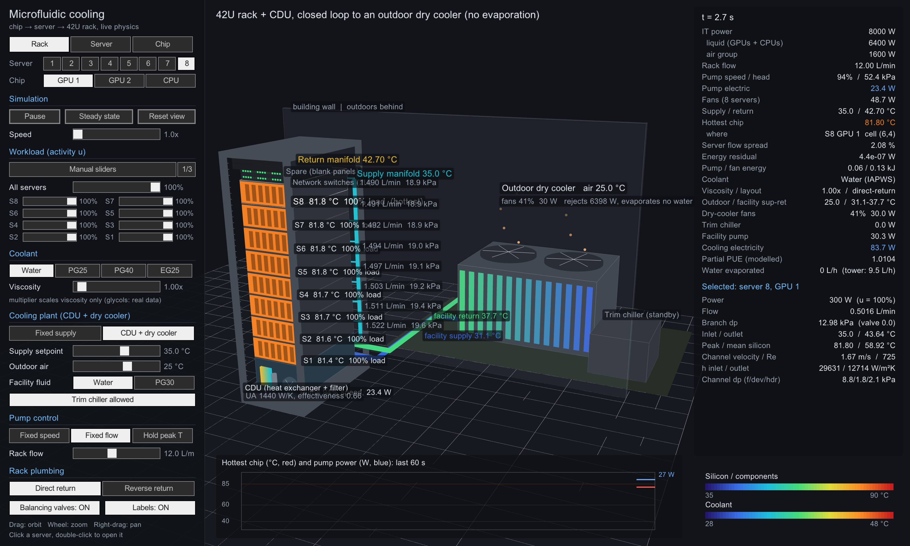
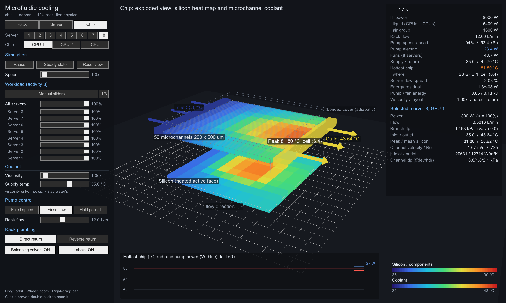

# Microfluidic cooling in a data center: simulation

A C++ simulation with a 3D viewer of a liquid-cooled 42U rack. It is built up from a single chip so that each level can be checked before the next is added. The research question is whether **coolant viscosity** limits the energy savings of **silicon microchannel cooling** combined with a **closed-loop coolant system**. The two ideas follow the NVIDIA and Microsoft work.



| Server (2 microchannel GPUs + cold-plate CPU) | Chip (exploded: silicon heat map + microchannels) |
|---|---|
|  |  |

## What is modelled (this milestone)

| Level | Model |
|---|---|
| **Coolant** | Water from IAPWS-IF97, IAPWS 2008 viscosity and IAPWS 2011 conductivity, checked against the releases' test values. Propylene and ethylene glycol mixtures (PG25, PG40, EG25 ...) from the Melinder (IIR) correlations, with freezing points. Selectable separately for the rack loop and the outdoor facility loop. A viscosity-only multiplier is available for the 1×/2×/4× experiment. |
| **Chip** | 20 × 20 mm die with 50 microchannels (200 × 500 µm). A 10 × 10 thermal RC grid with backward-Euler time stepping; coolant warms along the channels. Laminar developing-flow pressure drop and heat transfer with rib fin efficiency. |
| **Server** | Two 300 W microchannel GPUs and one 200 W cold-plate CPU in parallel branches with hoses, quick disconnects and balancing valves. Branch flows are solved from pressure balance. A 200 W air-cooled group with fan power. |
| **Rack** | 8 × 4U servers between rear supply and return manifolds (direct or reverse return), a pump curve with affinity laws and an efficiency curve, and three pump modes: fixed speed, fixed flow, or PI control on the hottest chip. A placeholder CDU resistance, hydrostatics, per-server workloads and a mixed return temperature. |
| **Cooling plant** | CDU plate heat exchanger (ε-NTU, conductance falls with coolant viscosity) feeding a sealed facility loop, an outdoor dry cooler with PI-controlled fans and bypass, and an optional trim chiller. Loop thermal mass, constant or daily-sine outdoor air. |
| **Energy** | Heat-balance residuals at every level, rack and facility pumps, dry-cooler fans, chiller, partial PUE, and water: 0 L/h evaporated, compared with what an evaporative tower would use. |

Parameter tables, boundary conditions, assumptions and the hand calculations are in **[docs/parameters.md](docs/parameters.md)**. Labelled schematics: [chip](docs/schematics/chip.svg), [server](docs/schematics/server.svg), [rack](docs/schematics/rack.svg), [cooling plant](docs/schematics/plant.svg).

**Not yet modelled:**
- room HVAC for the air-cooled load;
- the CNN workload. The `Workload` interface is ready for it.

## Build

Requirements: CMake 3.24 or newer and a C++20 compiler. On macOS that means the Xcode command-line tools. On Linux, raylib also needs the X11/OpenGL development packages. The first configure downloads four dependencies, each pinned by version and SHA-256: raylib 5.5, raygui 4.0, doctest 2.4.11 and nlohmann/json 3.11.3.

```bash
cmake -S . -B build -DCMAKE_BUILD_TYPE=Release
```

```bash
cmake --build build -j
```

```bash
ctest --test-dir build --output-on-failure
```

To build only the headless parts, add `-DMF_BUILD_VIEWER=OFF`.

## Run the 3D viewer

```bash
./build/mfsim_viewer --config configs/plant_baseline.json
```

| Action | How |
|---|---|
| Orbit / pan / zoom | left-drag / right-drag / wheel |
| Open a server | click a server, double-click to open it |
| Switch scene | keys 1, 2, 3 for rack / server / chip |
| Pause | Space |

The left panel controls:
- the per-server load, or a square-wave workload;
- the coolant (water, PG25, PG40, EG25) and its viscosity multiplier;
- the cooling plant: on/off, supply setpoint, outdoor air temperature, facility fluid (water or PG30), and the trim chiller;
- the pump mode and its target;
- the manifold layout and the balancing valves.

The right panel shows live flows, pressures, temperatures, pump and fan power, and the energy residual. To render one frame to a file without interacting, add `--scene chip --screenshot out.png`.

## Run experiments (headless)

```bash
./build/mfsim info --config configs/chip_baseline.json
```

```bash
./build/mfsim steady --config configs/rack_baseline.json
```

```bash
./build/mfsim sweep-viscosity --config configs/rack_baseline.json
```

```bash
./build/mfsim resolution --config configs/chip_baseline.json
```

```bash
./build/mfsim uneven-load --config configs/rack_baseline.json
```

```bash
./build/mfsim steady --config configs/plant_baseline.json
```

```bash
./build/mfsim climate-sweep --config configs/plant_baseline.json
```

```bash
./build/mfsim sweep-viscosity --config configs/plant_baseline.json --outdoor 30
```

```bash
./build/mfsim coolant-compare --config configs/plant_baseline.json
```

```bash
./build/mfsim run --config configs/rack_square_wave.json --duration 60 --dt 0.01
```

`--level chip|server|rack|plant` changes the level of any config; `--coolant PG25`, `--facility-coolant PG30`, `--outdoor C` and `--chiller off` override the config. Every command writes a CSV to `results/`.

## First findings

These are preliminary: CDU, dry-cooler and pump sizes are assumptions (see the parameters doc).

- The model reproduces the proposal's hand numbers: Re ≈ 660, channel Δp ≈ 13.5 kPa, GPU outlet 43.7 °C, and a mixed rack return of 42.70 °C for 6.4 kW at 12 L/min.
- **At a given flow, viscosity does not change chip temperatures**, because Re·Pr contains no μ. It changes pumping power instead. Holding the hottest chip at 85 °C takes about 10.1 L/min at 1×, 2× and 4× viscosity, while pump power rises from 14.7 W to 21.8 W to 37.5 W.
- If the pump isn't re-adjusted, 4× viscosity cuts flow to 8.2 L/min and the hottest chip reaches 89.4 °C.
- Direct-return manifolds give the top server the least flow (2 % spread). Reverse return evens this out (0.7 %).
- **With the cooling plant**, thicker coolant also weakens the CDU heat exchanger (UA −19 % at 4×), so the facility side must run colder. Holding 85 °C at 4× viscosity raises total cooling electricity from 70 W to 110 W at 25 °C outdoor, and from 557 W to 658 W at 30 °C (mostly chiller).
- **The dry cooler evaporates no water.** An evaporative tower would use about 9.5 L/h for the same 6.4 kW. The cost is electricity on hot days: partial PUE is 1.010 at 25 °C outdoor, 1.074 at 30 °C and 1.134 at 40 °C (chiller-assisted).
- **Real glycols cost more than viscosity alone suggests.** Glycol also has lower thermal conductivity and heat capacity, so PG25 needs about 55 % more flow to hold 85 °C, on top of being more viscous. The rack pump uses 4× the power of water (60 W against 15 W), and total cooling electricity is about 2.2× (151 W against 70 W at 25 °C outdoor). PG40 costs about 4.5×. EG25 is slightly better than PG25.
- **Freeze protection outdoors costs electricity too.** PG30 in the facility loop (frost-safe to −13 °C) raises plant electricity from 84 W to 166 W at 25 °C outdoor.

## Layout

```
src/core/      headless physics library (fluid, hydraulics, thermal, system, workload, config)
apps/mfsim/    experiments CLI
apps/viewer/   raylib + raygui 3D viewer
configs/       JSON configs (keys carry units)
tests/         doctest unit tests (IAPWS checks, analytic limits, energy and mass balance, controls)
docs/          parameters, schematics, screenshots
```

## License

MIT
