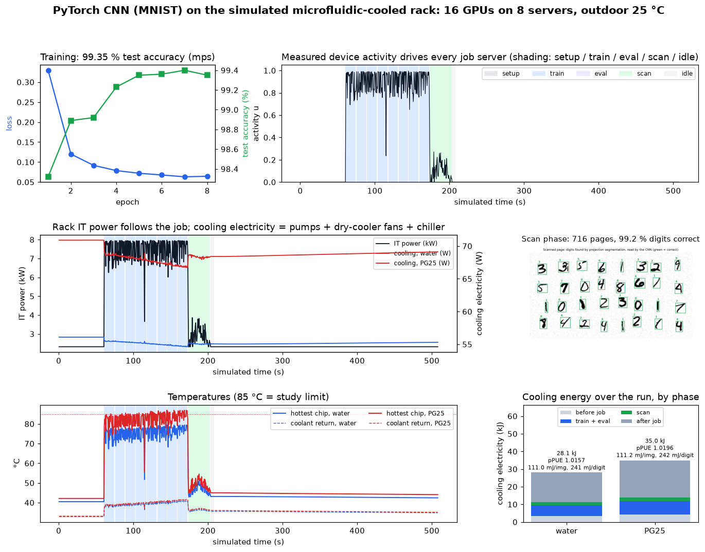
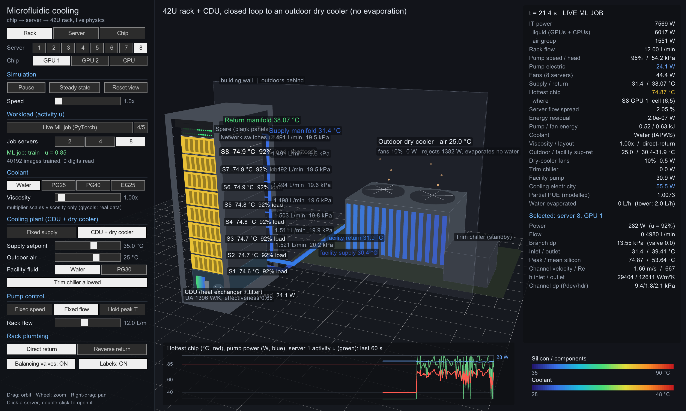

# CNN workload: a real PyTorch job driving the simulated data center

The proposal's workload chain is **requests → activity → power → spatial heat → chip and coolant temperatures**. This milestone closes the first link with a real machine-learning job. A convolutional neural network is trained to recognise handwritten digits, then answers on-demand "scan this page" requests. Its measured compute activity drives the simulated rack and cooling plant, either live or replayed afterwards.



## The model and data

| Item | Value |
|---|---|
| Dataset | **MNIST** handwritten digits (60 000 training / 10 000 test images, 28×28 grey). Downloaded once by `torchvision.datasets.MNIST` into `data/` |
| Model | 2 conv layers (32, 64 filters, 3×3) + max-pool + dropout + 2 fully connected layers. 1 199 882 parameters, ≈ 24 MFLOP per forward pass |
| Training | Adadelta (lr 1.0, ×0.7 per epoch), batch 128, 8 epochs, on-device random rotation/scale/shift augmentation |
| Result | **99.35 %** test accuracy (98.32 % after epoch 1), 4 244 training images/s on an Apple-silicon GPU (MPS), 113 s of training |
| Scanning ("detect numbers") | Synthetic scanned pages of 32 handwritten test digits with jitter and scanner noise. Digits are found by projection-profile segmentation (rows, then columns), normalised MNIST-style (20×20 box, centred by mass) and read by the CNN. Requests arrive as a Poisson process whose rate follows a demand curve: quiet, then peak, then quiet. |
| Scan result | 716 pages in 30 s; 705 pages segmented perfectly (all 32 digits found, 100 % recall overall); **99.18 %** of digits read correctly; median page latency 5.6 ms |


*A scanned page from the run. Each run also writes it to `results/ml/scan_example.png`. Green boxes and labels are correct readings.*

## From PyTorch to the rack: the activity trace

`ml/activity.py` measures, in every 0.1 s window of wall time, the fraction of the window the device spent executing work. That covers the forward and backward passes, the optimiser step, and inference batches. The device is synchronised at the end of each block, so asynchronous GPU queues are counted when they actually run. Data handling, page generation and segmentation on the host, and waiting for requests, count as not busy. Each window becomes one row: `t_s, u, phase, train_samples, infer_samples`.

That u(t) is exactly the simulator's workload input: each server's chips draw P = P_idle + u·(P_full − P_idle). Measured activity by phase:

| Phase | Mean u | What happens |
|---|---|---|
| setup | 0.00 | load data, build model |
| train | 0.90 | minibatch SGD |
| eval | 0.85 | test-set accuracy after each epoch |
| scan | 0.10 | bursty on-demand inference, idle between requests |
| idle | 0.00 | job finished |

**Mapping assumption.** Each simulated GPU runs a data-parallel replica of the job at the measured device's speed. With 16 GPUs the simulated job therefore processes 16× the measured samples. That is how energy per image and per digit are computed. A 300 W data-center GPU is much faster than a laptop GPU, so the per-unit energies are illustrative of the method, not of real hardware. The **shape** of the load (bursts, phases, idle gaps) is what the experiment really transfers.

Two ways to connect:
- **Live:** `ml/live_demo.sh` opens the 3D viewer with `--job live`, then starts training. The job servers follow `results/ml/activity_live.csv` as PyTorch writes it, so you can watch the rack heat up as each epoch runs. The left panel shows the phase, u, images trained and digits read.
- **Replay and energy analysis:** `mfsim cosim --trace results/ml/activity_trace.csv` replays the recorded job on the rack and cooling plant. The rack starts from an idle steady state, the job arrives after `--lead` seconds, and the run continues for `--tail` seconds after it ends. Energy is accounted per phase. `ml/report.py` draws the figure above.



## Results (8-epoch job on all 8 servers, 16 GPUs; outdoor 25 °C; fixed 12 L/min rack flow)

| | Water | PG25 |
|---|---|---|
| Hottest silicon during training | 79.9 °C | **87.4 °C** (exceeds the 85 °C limit) |
| Max coolant return | 41.0 °C | 41.8 °C |
| IT energy over the 508 s run | 1 775 kJ | 1 775 kJ |
| Cooling electricity over the run | 28.1 kJ | 35.0 kJ (+24 %) |
| Partial PUE over the run | 1.0157 | 1.0196 |
| Energy per training image (rack + cooling) | 0.111 J | 0.111 J |
| Energy per digit read while scanning | 0.241 J | 0.242 J |

What the co-simulation shows:

1. **Coolant choice decides whether the job fits the thermal limit.** With water the hottest chip stays below 80 °C. With PG25 at the same flow it exceeds 85 °C during training. This is the coolant comparison of §7c in [parameters.md](parameters.md), now under a real workload.
2. **Cooling does not follow an on-demand job with constant-flow pumping.** IT power steps from 2.3 kW idle to about 7.9 kW within a second of training starting. Cooling electricity barely moves; it even falls slightly, because warmer coolant is less viscous. The rack pumps run at full flow before, during and after the job, so most cooling energy is spent while the rack is idle.
3. **The loop's thermal mass absorbs a short job.** The equipment and facility loops hold about 40 L of coolant. During the 2-minute training burst the supply temperature rises only from about 31 °C to 34 °C, so the dry-cooler fans hardly speed up. A short job is effectively buffered.
4. **Inference on demand is expensive per item.** During scanning the GPUs are busy only 10 % of the time, but the servers draw idle power throughout. A digit read costs 0.24 J against 0.11 J per training image, even though a forward pass is about 3× cheaper than a training step. Idle power, not the network, dominates on-demand inference energy.

### Making cooling follow the job: variable flow with load feedforward

`--pump-mode peak --target-peak 78`: the rack pump holds the hottest chip at a target instead of pushing a constant 12 L/min.

**The first attempt failed.** A pure feedback controller let the pump slow almost to a stop at idle. When training began, chip power tripled within a second, and microchannel chips respond in about 30 ms. The controller only reacted after the chips were already hot, and **the hottest chip overshot to 116 °C**.

**The fix is feedforward from the load.**
- Pump speed is proportional to the commanded chip power, so it changes the instant the job arrives.
- The temperature error slowly tunes the speed-per-kW gain, with anti-windup.
- Speed never drops below 30 %.
- A negative error may pull speed down only a little, so cool idle chips cannot cancel the feedforward.

A regression test covers this: a load step must stay below 86 °C.

| Same 8-epoch job | Water, fixed 12 L/min | Water, variable flow | PG25, fixed 12 L/min | PG25, variable flow |
|---|---|---|---|---|
| Hottest silicon | 79.9 °C | 83.2 °C | **87.4 °C** | 81.9 °C |
| Cooling electricity, whole run | 28.1 kJ | **18.1 kJ (−36 %)** | 35.0 kJ | 28.0 kJ |
| Rack-pump energy in training | 2.6 kJ | 2.0 kJ | 4.0 kJ | **10.2 kJ** |
| Partial PUE | 1.0157 | 1.0101 | 1.0196 | 1.0157 |

With flow following the job, idle pumping almost vanishes and both coolants respect the 85 °C limit. The coolant penalty then concentrates where the work is: during training, PG25 needs **5× the pumping energy** of water to hold the same temperature. Brief spikes of a few kelvin remain, when activity jumps within 0.1 s, faster than the 50 ms control update. That is why the target is 78 °C, not 85 °C.

### A bigger job: thermal mass stops hiding it

`--time-scale 10` replays the same activity profile stretched to an 18-minute training run, representing a 10× larger job:

| Stretched ×10 | Water | PG25 |
|---|---|---|
| Max supply temperature | 35.9 °C (reaches the setpoint) | 36.1 °C |
| Hottest silicon | 82.6 °C | **89.8 °C** |
| Dry-cooler fan energy during training | 20.0 kJ (25 % of training cooling) | 31.8 kJ |
| Cooling electricity, whole run | 175 kJ (pPUE 1.0140) | 226 kJ (pPUE 1.0180) |

In the 2-minute job the dry-cooler fans used about 1 % of training-phase cooling energy (0.05 of 6.0 kJ). In the 18-minute job the loop warms to its setpoint and the fan controller has to work: 25 % of training cooling. So conclusions about cooling energy depend on job length relative to the plant's thermal time constants (minutes). Short bursts are buffered; long training runs reach steady state, where the coolant and climate results of [parameters.md](parameters.md) §5b–7c apply.

## How to run it

```bash
python3 -m venv .venv && .venv/bin/pip install torch torchvision matplotlib
```

```bash
ml/run_job.sh 8 water,PG25
```

```bash
ml/live_demo.sh 8 8
```

`ml/run_job.sh` trains, co-simulates and writes `results/ml/report.png`. `ml/live_demo.sh` shows the live 3D view while the job trains. Options for `mfsim cosim`:

| Option | Meaning |
|---|---|
| `--coolants water,PG25` | coolants to compare |
| `--job-servers 4` | put the job on fewer servers |
| `--pump-mode peak` | variable flow that holds the hottest chip at the limit |
| `--time-scale 10` | stretch the job, for a larger run with the same activity profile |
| `--outdoor 30` | outdoor air temperature |
| `--plant off` | fixed 35 °C supply instead of the cooling plant |
