# Simulation results report

*Generated by `analysis/make_report.py`. Every number below is read from the simulation output, and re-running the script regenerates the figures and the text.*

The model is described in the [README](../../README.md) and its inputs in [parameters.md](../parameters.md). Unless stated otherwise the configuration is the baseline: 8 × 4U servers, each with 2 × 300 W microchannel GPUs, a 200 W cold-plate CPU and a 200 W air-cooled group. The assumed GPU hotspot puts 50 % of the power in 25 % of the die, the coolant is water, and the 85 °C peak limit is a study assumption.

## Contents

1. [Chip: where the heat goes](#1-chip-where-the-heat-goes)
2. [Grid resolution](#2-grid-resolution)
3. [Server: balancing parallel branches](#3-server-balancing-parallel-branches)
4. [Rack: sharing flow between servers](#4-rack-sharing-flow-between-servers)
5. [Hydraulics: pressure budget and pump curves](#5-hydraulics-pressure-budget-and-pump-curves)
6. [Viscosity sensitivity](#6-viscosity-sensitivity)
7. [Practical coolants](#7-practical-coolants)
8. [Climate and the cooling plant](#8-climate-and-the-cooling-plant)
9. [Dynamics: a load step](#9-dynamics-a-load-step)
10. [A full day](#10-a-full-day)
11. [CNN workload](#11-cnn-workload)
12. [Navier-Stokes verification](#12-navier-stokes-verification)
13. [Boundary-driven flows](#13-boundary-driven-flows)

## 1. Chip: where the heat goes

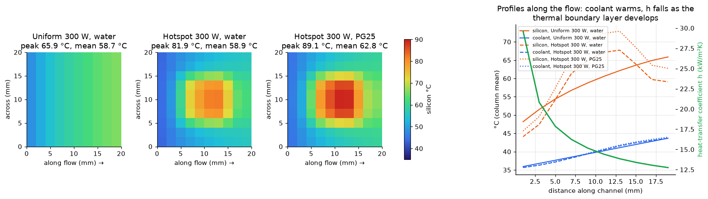

- **Uniform 300 W:** the silicon peaks at **65.9 °C**, at the outlet end where the coolant is warmest and the heat-transfer coefficient lowest.
- **With the assumed hotspot,** the same 300 W peaks at **81.9 °C**, 16.0 K hotter. That is within the 85 °C limit with little margin: the power map matters as much as the cooling.
- **PG25 instead of water** raises the hotspot peak to **89.1 °C** at the same 0.5 L/min. Glycol's lower thermal conductivity and heat capacity cost more than its viscosity.
- **Developing flow:** the heat-transfer coefficient falls from **29.6 kW/m²K** at the channel inlet to **12.8 kW/m²K** at the outlet. The thermal boundary layer is still developing over the whole 20 mm channel, so a fully developed correlation would under-predict cooling near the inlet.

## 2. Grid resolution

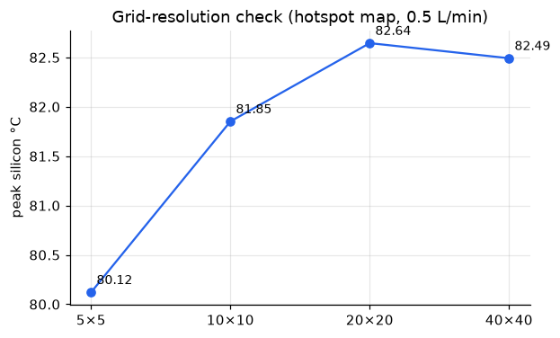

Peak temperature at 5×5: 80.12 °C, 10×10: 81.85 °C, 20×20: 82.64 °C, 40×40: 82.49 °C. Going from 10×10 to the finest grid changes the peak by **+0.64 K**. The coolant outlet temperature does not depend on the grid, because energy is conserved exactly. 10×10 is adequate for comparisons larger than about 1 K; use 20×20 for finer ones.

## 3. Server: balancing parallel branches

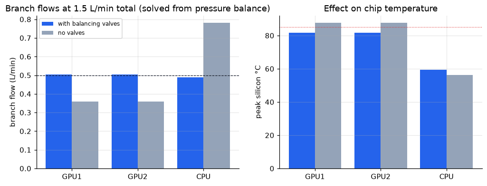

- **Without balancing valves,** the low-resistance CPU cold plate takes **0.78 L/min** and each GPU only **0.36 L/min**. The GPUs then run at **87.5 °C** instead of 81.7 °C.
- **The balancing valve** on the CPU branch absorbs **9.5 kPa**, so the branches share 0.51 / 0.51 / 0.49 L/min. This flow is solved from the pressure balance, not assumed.

## 4. Rack: sharing flow between servers

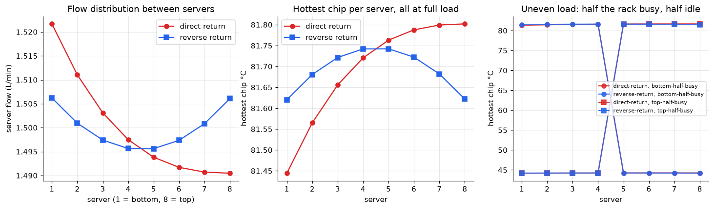

- **Direct-return manifolds** give the bottom server the shortest path, so flow falls from 1.522 to 1.490 L/min towards the top: a **2.1 %** spread. **Reverse return** cuts the spread to **0.7 %**.
- **The top server is hottest with direct return** because it gets the least flow, not because it is higher: elevation cancels in a closed loop.
- **Under uneven load** the hottest server is whichever busy server has the least flow, so the layout and the job placement together decide the hotspot.

## 5. Hydraulics: pressure budget and pump curves

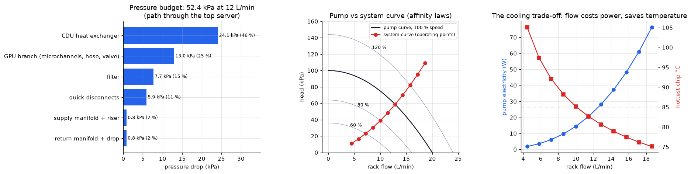

- **The pump delivers 52.4 kPa at 12 L/min.** The largest share goes to the CDU heat exchanger (24.1 kPa, 46 %). The microchannel GPU branch takes 13.0 kPa. The manifolds are almost free, which is why flow is shared so evenly between servers.
- **Pumping energy is therefore set mostly by components outside the chip.** Any viscosity penalty applies to the laminar parts of all of them, not only the microchannels.
- **The operating points** move along the system curve as pump speed changes. More flow lowers chip temperature with diminishing returns, while pump power rises roughly with the cube of speed.

## 6. Viscosity sensitivity

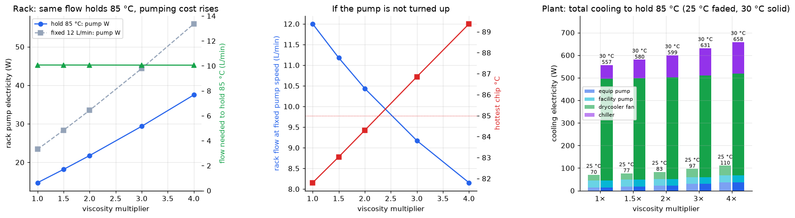

- **Holding 85 °C needs the same flow at any viscosity:** 10.07 L/min at 1× and 10.05 L/min at 4×. Re·Pr, which governs microchannel heat transfer, contains no viscosity.
- **The pump pays instead:** 14.7 W at 1× rises to 37.5 W at 4×, which is 2.5×. Head rises from 39 to 95 kPa.
- **If the pump is not turned up,** flow falls to 8.2 L/min at 4× and the hottest chip reaches **89.4 °C**.
- **With the cooling plant,** viscosity also weakens the CDU heat exchanger: UA falls from 1369 to 1104 W/K at 4×. The facility side must then run colder. Total cooling electricity to hold 85 °C goes from **70 → 110 W** at 25 °C outdoor and **557 → 658 W** at 30 °C, where the chiller has to make up the difference.

## 7. Practical coolants

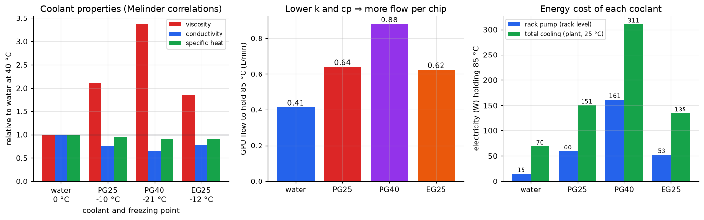

- **PG25** is 2.1× as viscous as water at 40 °C, with 23 % lower conductivity and 5 % lower heat capacity. It freezes at -10.2 °C.
- **More flow per chip:** each GPU needs 0.64 L/min of PG25 against 0.41 L/min of water to hold 85 °C, and 0.88 L/min of PG40.
- **Rack pump power** to hold 85 °C: water 15 W, EG25 53 W, PG25 60 W, PG40 161 W. **Total cooling** at 25 °C outdoor: water 70 W, PG25 151 W, PG40 311 W.
- **Real glycols cost more than the viscosity-only experiment suggests**, because their thermal properties also get worse. Glycol data carry about ±20 % uncertainty in viscosity.

## 8. Climate and the cooling plant

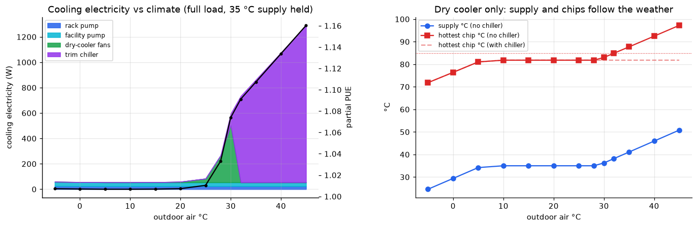

- **Mild weather:** up to about 25 °C outdoors the dry cooler alone holds a 35 °C supply. Cooling uses 84 W at 25 °C, a partial PUE of 1.010.
- **Warm weather:** from about 30 °C the fans are at full speed and the trim chiller starts. At 45 °C cooling needs 1290 W, a partial PUE of 1.160.
- **Without a chiller** the supply follows the weather: at 35 °C outdoors the supply is 41.1 °C and the hottest chip 87.7 °C.
- **Water:** the closed loop evaporates no water in any climate. An evaporative tower rejecting the same heat would use about 9.5 L/h. The saving costs electricity only on hot days.

## 9. Dynamics: a load step

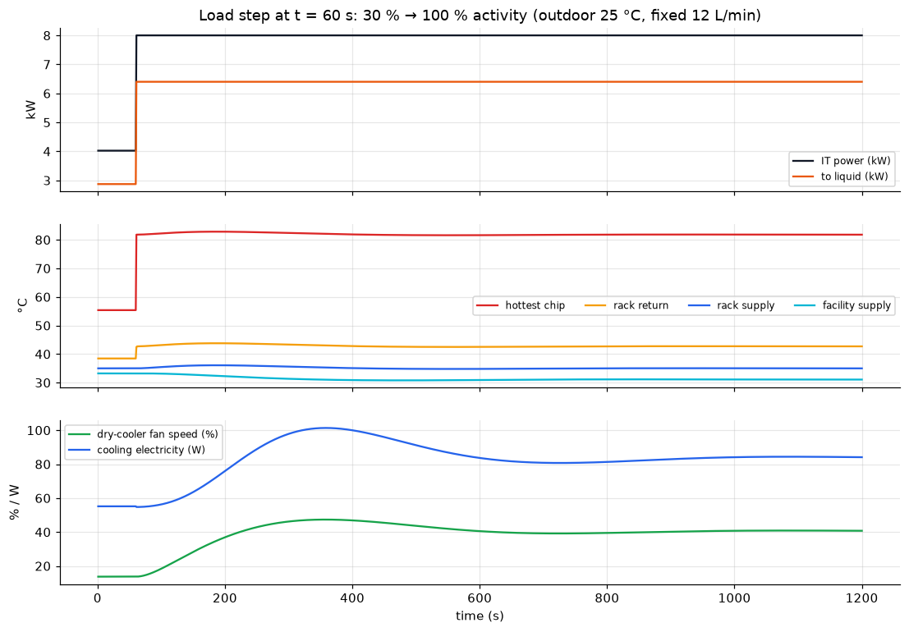

- **The load step:** activity jumps from 30 % to 100 % at t = 60 s. Chip temperatures respond within seconds (the silicon time constant is about 30 ms; the coolant transit and loop volumes take longer).
- **The loop's thermal mass** lets the supply overshoot only to **36.08 °C** while the dry-cooler fans speed up from 14 % to 41 %. The fan controller returns the supply to 35 °C (it ends at 34.99 °C).
- **Cooling electricity** rises from 55 W to 84 W. The fans, not the pumps, carry the change, because the rack pump runs at constant flow in this configuration.

## 10. A full day

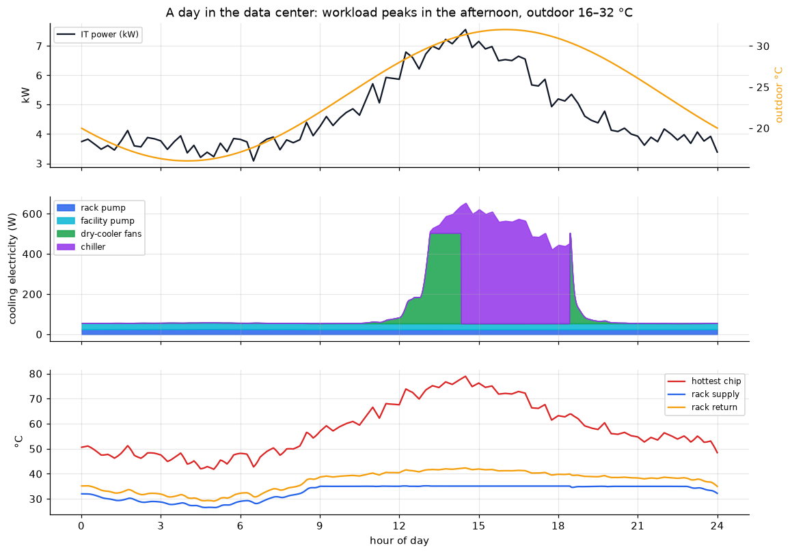

- **Over 24 hours** the rack uses **113.0 kWh** of IT energy and **4.24 kWh** of cooling electricity, a partial PUE of **1.0373**.
- **The hot afternoon** coincides with peak load. The trim chiller runs for 5.3 h (2.09 kWh) and the dry-cooler fans use 0.83 kWh. The hottest chip reaches 78.9 °C.
- **The economizer rule at work:** from about 14.3 h the outdoor air is too warm for the dry cooler to be worth its fan power. The water then bypasses it and the chiller carries the whole load for 4.1 h (the green band turning purple), until the evening cools down.
- **Water:** no water is evaporated. A cooling tower would have evaporated roughly 124 L for the same liquid heat load.

## 11. CNN workload

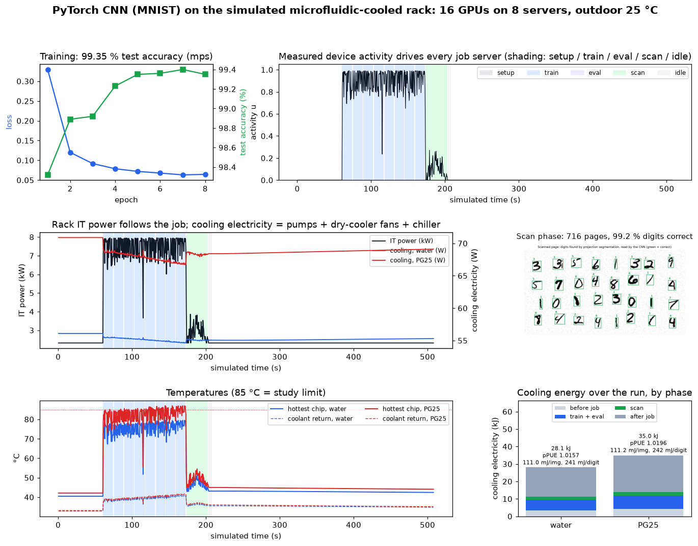

- **The job:** a PyTorch CNN trained on MNIST reaches **99.35 %** test accuracy, then reads 22923 digits on 716 scanned pages (99.2 % correct). Its measured device activity drives the rack; see [ml_workload.md](../ml_workload.md).
- **Fixed 12 L/min:** the hottest chip reaches 79.9 °C with water and **87.4 °C with PG25**.
- **Variable flow with load feedforward:** 83.2 °C and 81.9 °C. Cooling energy falls from 28.1 to 18.1 kJ for water.

## 12. Navier-Stokes verification

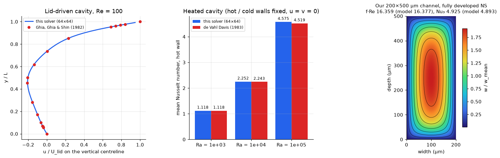

The rack model uses reduced-order physics: an energy-conserving thermal network plus channel correlations. To check that this is justified, a separate solver integrates the full 2-D incompressible Navier-Stokes and energy equations (Boussinesq buoyancy, staggered finite volumes, projection method). It is first verified against the standard published benchmarks:
- **Lid-driven cavity, Re = 100:** the centreline velocity matches Ghia, Ghia & Shin (1982) within **0.005** of the lid speed at every tabulated point.
- **Differentially heated cavity:** Nusselt numbers against de Vahl Davis (1983): Ra 1e+03: 1.118 vs 1.118 (+0.0 %), Ra 1e+04: 2.252 vs 2.243 (+0.4 %), Ra 1e+05: 4.575 vs 4.519 (+1.2 %).
- **Our own 200 × 500 µm channel,** solved as fully developed Navier-Stokes + energy on its cross-section: f·Re = **16.359** against the 16.377 the chip model uses (-0.11 %). The three-wall Nusselt number is **4.925** against 4.893 (+0.6 %). **The correlations in the chip model are confirmed by a first-principles solution.**

## 13. Boundary-driven flows

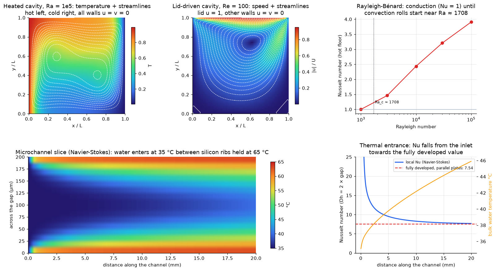

Each case is set entirely by its boundaries. Every wall has a prescribed velocity (u, v): zero by default (no-slip), or a moving wall, or an inflow. Each wall is held at a fixed hot or cold temperature, or insulated. The interactive CFD scene of the viewer (key 5) lets you change any of these while the flow is running.
- **Heated cavity:** with all walls at rest, buoyancy alone drives a single circulating cell. Hot fluid rises along the hot wall and sinks along the cold one, and thin thermal boundary layers form.
- **Rayleigh-Bénard:** heated from below, the fluid conducts (Nu = 1.00 at Ra = 1000) until it passes the critical Rayleigh number (about 1708). Then convection rolls carry more heat: Nu = 3.91 at Ra = 1e+05.
- **Microchannel slice:** water at 1.67 m/s between ribs at 65 °C. The local Nusselt number falls from about 71 near the inlet to 7.7 at 20 mm, still above the fully developed 7.54. This confirms that the flow is thermally developing over the whole channel, as the chip model assumes. The water leaves at 45.9 °C.

## Limitations

- **Assumed values:** the hotspot pattern, idle powers, and the cold-plate, quick-disconnect, CDU, dry-cooler and pump curves are assumptions; see [parameters.md](../parameters.md).
- **Simplifications:** the chip model uses a 2-D grid with a lumped fin; microchannel heat transfer uses a thermal-entrance approximation; flow is assumed equal across the 50 channels.
- **Not modelled:** room HVAC for the air-cooled load, and glycol inhibitors.
